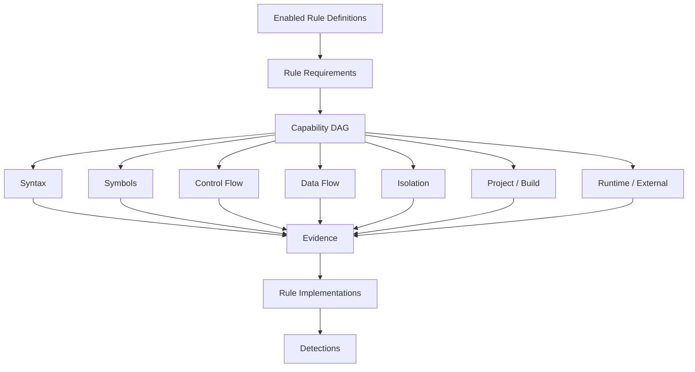

# SwiftDebt R2 — PRD Addendum

## A. Purpose
This addendum captures proposed mechanisms supporting the PRD. These are architectural recommendations, not product requirements unless promoted into an FR. The design preserves R1 authority while making the 100-item research catalog executable incrementally. The central mechanism is `Research Claim → Rule Definition → Requirements/Evidence → Rule Implementation → Detection → R1 reconciliation`. Rules should consume evidence rather than each rebuilding analyzers.

## B. Proposed Domain Shape

```swift
public struct RuleDefinition: Sendable {
    public let identity: RuleIdentity
    public let metadata: RuleMetadata
    public let scope: RuleScope
    public let mode: DetectionMode
    public let requirements: RuleRequirements
    public let evidenceContract: EvidenceContract
    public let semanticRevision: SemanticRevision
}
```

`RuleDefinition` says what SwiftDebt claims. `RuleImplementation` says how this release observes the claim. This allows Implementation Revision to change for optimization/bug fixes without necessarily changing Semantic Revision.

```swift
public protocol RuleImplementation: Sendable {
    associatedtype Context: AnalysisContextProtocol
    var definition: RuleDefinition { get }
    func detect(in context: Context, emit: DetectionEmitter) throws
}
```

## C. Analysis Capability Vocabulary

A capability set should cover at least:

```swift
enum AnalysisCapability: Hashable, Sendable {
    case syntax, metrics, symbols, types, references, ownership
    case isolation, controlFlow, dataFlow
    case moduleGraph, dependencyGraph, callGraph
    case buildConfiguration, packageManifest, xcodeProject
    case gitHistory, semanticSimilarity
    case runtimeEvidence, externalEvidence
}
```

Use a set/dependency graph rather than `OptionSet`: the vocabulary will grow and some capabilities depend on others. Example: `actorReentrancyEvidence` may require syntax + isolation + controlFlow + dataFlow. The engine resolves dependency closure once for enabled rules. This is the R2 precursor to R3's query planner.



## D. Scope Model

Recommended scopes:

```swift
enum RuleScope: Sendable {
    case syntax
    case sourceUnit
    case repository
    case project
    case history
    case runtime
    case external
}
```

Do not force build/CI/history claims through `SourceFileSyntax`. Source-local rules should remain lightweight. Broader contexts can be introduced only when exercised by concrete claims.

## E. Evidence Algebra

A flat set of evidence kinds will be insufficient for claims with alternative valid evidence paths. Recommended shape:

```swift
public indirect enum EvidencePredicate: Sendable {
    case fact(EvidenceRequirement)
    case all([Self])
    case any([Self])
    case not(Self)
}
```

For blocking semaphore use, the contract can conceptually express:

```text
DispatchSemaphore.wait
AND
(async context OR MainActor context)
```

For actor reentrancy:

```text
invariant established
AND suspension point
AND post-suspension use
AND no sufficient revalidation
```

The catalog declares the contract; Swift implements the algorithms. Avoid a generic expression language in YAML.

## F. Typed Evidence

Avoid `[String:String]` or arbitrary metadata. Suggested hierarchy:

```swift
public enum EvidenceFact: Sendable {
    case syntax(SyntaxEvidence)
    case metric(MetricEvidence)
    case relationship(RelationshipEvidence)
    case isolation(IsolationEvidence)
    case controlFlow(ControlFlowEvidence)
    case configuration(ConfigurationEvidence)
    case history(HistoryEvidence)
    case similarity(SimilarityEvidence)
}
```

Evidence remains snapshot-local and may reference source locations/SemanticUnit IDs. It must never carry `FindingID`. The pipeline remains `Facts → Evidence → Detection → Reconciler → Finding`.

## G. Sensor → Fact → Evidence → Rule

Rules should not become giant AST visitors. Proposed internal architecture:


Candidate sensors include Syntax, Call, Type, Isolation, ControlFlow, DataFlow, Reference, Package, XcodeProject, Git, and future CI/runtime providers. Sensors do not know rules. Multiple rules can reuse the same facts.

## H. Rule Catalog Manifest

A declarative catalog is recommended for semantics/metadata while executable detection remains Swift. Example:

```yaml
id: concurrency.actor-reentrancy
semanticRevision: 1
category: concurrency
scope: sourceUnit
detectionMode: derived
requirements:
  - syntax
  - isolation
  - controlFlow
  - dataFlow
evidence:
  all:
    - invariantEstablished
    - suspensionPoint
    - postSuspensionUse
    - noSufficientRevalidation
implementation:
  builtin: actorReentrancy
supportState: partial
provenance:
  researchItem: 19
```

Do not add arbitrary executable expressions to the manifest. YAML/JSON should describe contracts; Swift should implement algorithms. Generation may produce validated Swift metadata if compile-time guarantees are desirable.

## I. Stable IDs

Research numbers are provenance only. Prefer semantic IDs:

```text
architecture.mixed-responsibilities
architecture.circular-module-dependency
architecture.global-shared-dependency
concurrency.unchecked-sendable
concurrency.unsafe-nonisolated
concurrency.blocking-semaphore-in-async
concurrency.actor-reentrancy
errors.force-try
errors.suppressed-try
types.force-unwrap
types.force-cast
types.primitive-identifier
swiftui.observed-object-owned-by-view
build.swiftpm-unsafe-flags
ci.unpinned-xcode
observability.production-print
```

IDs should survive catalog reorder and implementation renames.

## J. Example Mappings from the Research

### Research #28 — `try!`
Primary capability: syntax. Detection Mode: Deterministic for presence of `try!`; a more specific “fallible external boundary” variant additionally requires symbol/call classification. Do not pretend the broad syntax rule proves the full contextual research statement.

### Research #12 — `DispatchSemaphore.wait()` in async
Capabilities: syntax + symbols/context. Detect resolved semaphore wait inside async or MainActor-sensitive execution. This is high-confidence derived/deterministic evidence when call resolution is known.

### Research #19 — Actor reentrancy
Capabilities: syntax + isolation + control flow + data flow. Evidence tracks invariant establishment, suspension, post-suspension state use, and revalidation. This is a Derived rule, not AST pattern matching.

### Research #1 — Mixed responsibilities in UI/model type
Capabilities: symbols + references + ownership, possibly dependency classification. Evidence should identify presentation/networking/persistence/domain responsibilities rather than using LOC alone. This is likely Derived/Heuristic.

### Research #3 — Global `shared` dependency
`static let shared` is a candidate, not automatically debt. Additional evidence may include mutable state, broad usage, missing substitution boundary, and cross-module references. This prevents harmless shared immutable utilities from being universally flagged.

### Research #40 — Primitive identifiers
Lexical/type/reference evidence can identify distinct semantic ID concepts represented by `String`/`Int`. Semantic similarity may generate candidates but cannot directly emit a Detection.

### Research #46 — SwiftUI `@ObservedObject` owned by View
This is a strong source-local rule when the property wrapper, initialization, and ownership conditions are observable. It demonstrates why many catalog items remain cheap even after the architecture becomes richer.

### Research #71 — SwiftPM `unsafeFlags`
This belongs to package/project scope, not a source syntax rule. A `PackageAnalysisContext` can expose manifest facts without contaminating source-local rule APIs.

### Research #86–92 — CI/CD
These require CI/project configuration sensors or external evidence. R2 should catalog them now and avoid pretending ordinary Swift analysis can prove them.

## K. Detection Mode

Recommended:

```swift
enum DetectionMode: Sendable {
    case deterministic
    case derived
    case heuristic
    case historical
    case runtimeDependent
    case external
}
```

This is epistemic metadata, not severity and not probability. A semantic-similarity score remains an evidence value.

## L. Observation State

Recommended result concept:

```swift
enum ObservationState: Sendable {
    case complete
    case partial(reason: PartialReason)
    case unavailable(reason: UnavailableReason)
    case failed(AnalysisFailure)
    case disabled
}
```

CLI should summarize evaluated/partial/unavailable/disabled counts separately from Detections. This prevents `0 detections` from meaning `0 debt` when a rule could not observe its domain.

## M. Policy Boundary

Do not place universal severity in Rule Definition. Example policy may fail `errors.force-try` under production source while warning/ignoring controlled tests. Policy changes should not alter Semantic Revision. Rule Implementations observe; they do not decide build failure.

## N. Suggested Catalog Categories

- architecture
- concurrency
- memory
- errorHandling
- typeSafety
- uiFramework
- testing
- build
- objectiveCInterop
- performance
- ci
- compilerEvolution
- style
- observability

The supplied research headings map naturally to these categories. Category is metadata; it does not determine execution.

## O. Validation Strategy

Every Supported rule should have positive fixtures, adversarial negative fixtures, evidence-shape tests, observation-completeness tests, and performance characterization appropriate to its capabilities. Catalog validation should test identity uniqueness, provenance coverage, requirement validity, support-state consistency, and Evidence Contract validity. Derived/heuristic rules need explicit false-positive/false-negative documentation. Runtime/external claims need tests proving they do not become false absence when providers are missing.

## P. R2 → R3 Seam

R2 should introduce capability semantics without overbuilding the R3 planner. R3 can later turn the requirement set into a full DAG with shared RepositoryGraph/EvidenceGraph indexes. This seam preserves R2's performance promise and avoids a breaking conceptual migration. Rule Definitions should therefore depend on domain capabilities, never concrete databases or graph implementations. The vector database remains an implementation behind similarity capabilities.

## Q. Key Architectural Invariants

1. Research Claim is not automatically Rule Implementation.
2. Rule Definition semantics are independent of implementation type.
3. Missing Evidence is not negative Evidence.
4. Evidence is snapshot-local; Finding is historical.
5. Rule observes; Engine reconciles; Policy reacts.
6. Location is evidence, not canonical identity.
7. Similarity generates evidence/candidates, not authoritative debt.
8. Expensive capabilities execute only when required.
9. Catalog coverage claims derive from catalog state, not documentation prose.
10. Unsupported/unobservable claims remain visible rather than silently disappearing.
