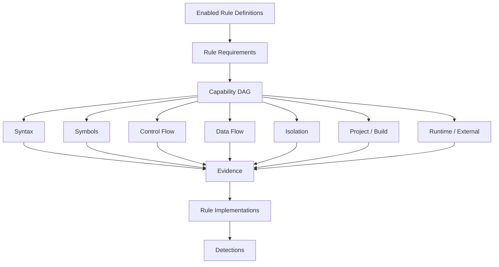

# SwiftDebt R2 - PRD Addendum

---

## A. Purpose
This addendum proposes mechanisms for the [R2 Rule Catalog PRD](prd.md). They are design recommendations, not product requirements unless promoted into an FR. It retains the old branch's useful capability/evidence ideas while replacing its unauthenticated 100-item source and YAML ownership with the [single Swift-authored catalog decision](../adr/0002-r2-rule-catalog-source-and-authoring.md). The central path is `Source Claim or SwiftDebt Extension → Rule Definition → Requirements/Evidence → Rule Implementation → Detection → existing reconciliation`. Current main's Fowler schema 1, analysis schema 2, compiler-evidence sidecar, and lifecycle behavior remain authoritative. Rules consume shared evidence instead of rebuilding analyzers.

---

## B. Domain shape and the released R1 seam

Current main already has `RuleDescriptor(identity:metadata:contract:)` and `RuleMetadata.defaultSeverity` in `Sources/SwiftDebtCore/RuleIdentity.swift`. Source rules implement `DebtRule.detect(in: AnalysisContext, emit:)` with a concrete `AnalysisContext` in `Sources/SwiftDebtSyntax/DebtRule.swift`. The old branch's similarly named `RuleDefinition`, `RuleIdentity`, and marker-only `AnalysisContextProtocol` / `RuleImplementation` are **not** drop-in types.

Author one canonical typed Rule Definition registry for **all** accepted claims: identity and provenance, support state, scope, mode, capabilities, evidence contract, and semantic/implementation/evidence revisions. The exact Swift type is an implementation choice, but the registry is not a second authored copy of the 24 Fowler entries. Keep main's public `RuleDescriptor` as an execution compatibility projection for supported R1 rules, and main's 24-entry `RefactoringCodeSmellCatalog` as a report compatibility projection; prove both stay consistent with the registry. R1's `defaultSeverity` stays on its compatibility descriptor until policy consumers can use a separate policy input; it is not a universal property of a catalog claim. Do not force severity onto unsupported definitions.

Keep the existing concrete source-local `AnalysisContext` and `DebtRule` behavior. Introduce concrete project/history/external contexts only when a scoped rule has a provider and a verified end-to-end consumer. A marker protocol that merely permits a conformer to compile is not a working FR-14 implementation. Implementation Revision may change for optimization or bug fixes without changing Semantic Revision; evidence and policy changes have their own acceptance checks.

---

## C. Analysis Capability Vocabulary

A capability set should cover at least:

```swift
enum AnalysisCapability: Hashable, Sendable {
    case syntax, metrics, symbols, types, references, ownership
    case isolation, controlFlow, dataFlow
    case moduleGraph, dependencyGraph, callGraph
    case buildConfiguration, packageManifest, xcodeProject
    case gitHistory, semanticSimilarity
    case runtimeEvidence, externalEvidence
}
```

Use a set/dependency graph rather than `OptionSet`: the vocabulary will grow and some capabilities depend on others. Example: `actorReentrancyEvidence` may require syntax + isolation + controlFlow + dataFlow. The engine resolves dependency closure once for enabled rules. This is the bounded R2 capability resolver, not a duplicate of main's released lifecycle or R3's query planner.



---

## D. Scope Model

Recommended scopes:

```swift
enum RuleScope: Sendable {
    case syntax
    case sourceUnit
    case repository
    case project
    case history
    case runtime
    case external
}
```

Do not force build/CI/history claims through `SourceFileSyntax`. Source-local rules should remain lightweight. Broader contexts can be introduced only when exercised by concrete claims.

---

## E. Evidence Algebra

A flat set of evidence kinds will be insufficient for claims with alternative valid evidence paths. Recommended shape:

```swift
public indirect enum EvidencePredicate: Sendable {
    case fact(EvidenceRequirement)
    case all([Self])
    case any([Self])
    case not(Self)
}
```

For blocking semaphore use, the contract can conceptually express:

```text
DispatchSemaphore.wait
AND
(async context OR MainActor context)
```

For actor reentrancy:

```text
invariant established
AND suspension point
AND post-suspension use
AND no sufficient revalidation
```

The catalog declares the contract; Swift implements the algorithms. Avoid a generic expression language in YAML.

---

## F. Typed Evidence

Avoid `[String:String]` or arbitrary metadata. Suggested hierarchy:

```swift
public enum EvidenceFact: Sendable {
    case syntax(SyntaxEvidence)
    case metric(MetricEvidence)
    case relationship(RelationshipEvidence)
    case isolation(IsolationEvidence)
    case controlFlow(ControlFlowEvidence)
    case configuration(ConfigurationEvidence)
    case history(HistoryEvidence)
    case similarity(SimilarityEvidence)
}
```

Evidence remains snapshot-local and may reference source locations/SemanticUnit IDs. It must never carry `FindingID`. The pipeline remains `Facts → Evidence → Detection → Reconciler → Finding`.

---

## G. Sensor → Fact → Evidence → Rule

Rules should not become giant AST visitors. Proposed internal architecture:


Candidate sensors include Syntax, Call, Type, Isolation, ControlFlow, DataFlow, Reference, Package, XcodeProject, Git, and future CI/runtime providers. Sensors do not know rules. Multiple rules can reuse the same facts.

---

## H. Swift-authored Rule Catalog

The canonical catalog consists of typed Swift Rule Definitions, not YAML, JSON, generated metadata, or an independently authored legacy catalog. Current main's `RefactoringCodeSmellCatalog` supplies the published 24-smell projection; evolve its backing definitions to a single authoritative registry and preserve its schema 1 report bytes. Reuse main's `RuleIdentity` and `SemanticRevision` rather than porting same-named branch types. An additional wider report must have its own explicit schema version.

For an actor-reentrancy **candidate**, a definition would declare a stable identity, derived detection mode, source-unit scope, isolation/control-flow/data-flow requirements, and an Evidence Contract covering invariant establishment, suspension, post-suspension use, and absence of sufficient revalidation. Until all required evidence can be obtained and tested, its Support State remains Partial or Research. Compare the candidate against the 24 Fowler smells before assigning a distinct SwiftDebt-extension provenance and cite Swift concurrency facts independently from SwiftDebt's debt judgment.

Catalog validation checks uniqueness, provenance, requirement references, evidence metadata, and Support State consistency against these Swift definitions. Do not port the old branch's manifest parser or validation plugin. Rule Implementations remain Swift algorithms; arbitrary executable expressions in metadata are out of scope.

---

## I. Stable IDs

The unauthenticated draft's item numbers are not provenance. These are provisional semantic IDs for candidate mappings, not preapproved catalog entries. Check for an existing Fowler identity before assigning a distinct extension:

```text
architecture.mixed-responsibilities
architecture.circular-module-dependency
architecture.global-shared-dependency
concurrency.unchecked-sendable
concurrency.unsafe-nonisolated
concurrency.blocking-semaphore-in-async
concurrency.actor-reentrancy
errors.force-try
errors.suppressed-try
types.force-unwrap
types.force-cast
types.primitive-identifier
swiftui.observed-object-owned-by-view
build.swiftpm-unsafe-flags
ci.unpinned-xcode
observability.production-print
```

Once accepted, identities survive catalog reorder and implementation renames. Main's existing `RuleIdentity` and report schema 1 remain the compatibility baseline.
Canonical dot-form identity `namespace.rule-id` uses main's `RuleIdentity(namespace: RuleNamespace, id: RuleID)`; never port the older single-string `RuleIdentity` type or infer provenance from an ID prefix.

---

## J. Candidate Swift mappings, not research numbers

These are examples from the archived draft, not a sourced list or approved extension count. For each, first test whether an existing Fowler claim expresses the same smell. Cite primary technical documentation before accepting a distinct SwiftDebt-authored policy judgment. A narrower syntax detector must not claim the full contextual conclusion.

### Candidate: `try!`

Syntax observes the operator deterministically. A claim about a fallible external boundary additionally needs reliable symbol/call classification; it is not proven by the operator alone.

### Candidate: `DispatchSemaphore.wait()` in async execution

Require resolved semaphore use and an async or MainActor-sensitive context. Matching an arbitrary method named `wait` cannot establish the claim; unresolved binding leaves observation incomplete.

### Candidate: actor reentrancy

Require isolation, control-flow, and data-flow evidence for invariant establishment, suspension, post-suspension use, and lack of sufficient revalidation. An `await` alone is not a detector.

### Candidate: mixed UI/model responsibilities

Compare first with Fowler's Large Class and Divergent Change. Evidence must distinguish presentation, networking, persistence, and domain responsibilities, rather than merely measuring LOC.

### Candidate: global `shared` dependency

Compare first with Fowler's Global Data. A `static let shared` occurrence is only a candidate; mutable state, broad use, and missing substitution boundaries may be needed. Immutable utilities are not automatically debt.

### Candidate: primitive identifiers

Compare first with Fowler's Primitive Obsession. Type/reference evidence can identify distinct semantic ID concepts represented by `String` or `Int`; similarity can propose candidates but cannot independently emit a Detection.

### Candidate: SwiftUI `@ObservedObject` owned by a View

A source-local observation needs property-wrapper, initialization, and ownership evidence. Its debt interpretation is a SwiftDebt-authored judgment, not an Apple documentation claim.

### Candidate: SwiftPM `unsafeFlags`

A package/project-scoped context may expose manifest facts. Presence alone is not sufficient to infer a CI or portability failure, and this cannot be implemented by inventing a source syntax node.

### Candidate: CI/CD configuration

Each separately accepted claim needs a named configuration sensor or external provider. Ordinary Swift source cannot prove CI policy. Unavailable provider evidence is not clean absence; the old draft's numbered range does not define entries.

---

## K. Detection Mode

Recommended:

```swift
enum DetectionMode: Sendable {
    case deterministic
    case derived
    case heuristic
    case historical
    case runtimeDependent
    case external
}
```

This is epistemic metadata, not severity and not probability. A semantic-similarity score remains an evidence value.

---

## L. Observation State

Recommended result concept:

```swift
enum ObservationState: Sendable {
    case complete
    case partial(reason: PartialReason)
    case unavailable(reason: UnavailableReason)
    case failed(AnalysisFailure)
    case disabled
}
```

CLI should summarize evaluated/partial/unavailable/disabled counts separately from Detections. This prevents `0 detections` from meaning `0 debt` when a rule could not observe its domain.
The wider five-state Support State applies to the new catalog, not to a silent rewrite of main's four-case `CodeSmellSupportState`. The schema-1 adapter projects only the original 24 Fowler entries and preserves each existing four-case value. SwiftDebt extensions, including external/runtime-required entries, belong in a separate versioned view; do not coerce external absence to a schema-1 `research` result.

---

## M. Policy Boundary

Do not place universal severity in Rule Definition. Example policy may fail `errors.force-try` under production source while warning/ignoring controlled tests. Policy changes should not alter Semantic Revision. Rule Implementations observe; they do not decide build failure.

---

## N. Suggested Catalog Categories

- architecture
- concurrency
- memory
- errorHandling
- typeSafety
- uiFramework
- testing
- build
- objectiveCInterop
- performance
- ci
- compilerEvolution
- style
- observability

The publisher-backed Fowler names and individually accepted SwiftDebt extensions may use these categories. Category is metadata; it does not determine execution.

---

## O. Validation Strategy

Every Supported rule should have positive fixtures, adversarial negative fixtures, evidence-shape tests, observation-completeness tests, and performance characterization appropriate to its capabilities. Catalog validation should test identity uniqueness, provenance coverage, requirement validity, support-state consistency, and Evidence Contract validity. Derived/heuristic rules need explicit false-positive/false-negative documentation. Runtime/external claims need tests proving they do not become false absence when providers are missing.
Swift type checking verifies catalog shape; test/build validation checks cross-entry consistency without YAML code generation. At runtime, invalid configuration disables only the affected rule with an explicit reason, and it cannot prove absence. The released compiler-evidence sidecar remains separate from rule validation.

---

## P. R2 → R3 Seam

R2 should introduce capability semantics without overbuilding the R3 planner. R3 can later turn the requirement set into a full DAG with shared RepositoryGraph/EvidenceGraph indexes. This seam preserves R2's performance promise and avoids a breaking conceptual migration. Rule Definitions should therefore depend on domain capabilities, never concrete databases or graph implementations. The vector database remains an implementation behind similarity capabilities.

---

## Q. Key Architectural Invariants

1. A Fowler source claim or SwiftDebt extension is not automatically a Rule Implementation.
2. Rule Definition semantics are independent of implementation type.
3. Missing Evidence is not negative Evidence.
4. Evidence is snapshot-local; Finding is historical.
5. Rule observes; Engine reconciles; Policy reacts.
6. Location is evidence, not canonical identity.
7. Similarity generates evidence/candidates, not authoritative debt.
8. Expensive capabilities execute only when required.
9. Catalog coverage claims derive from catalog state, not documentation prose.
10. Unsupported/unobservable claims remain visible rather than silently disappearing.
